# 🏆 GitHub 成就 🏆

 

  <picture>
    <source media="(prefers-color-scheme: light)" srcset="https://user-images.githubusercontent.com/65187002/172940015-d9d072e7-c47d-4ddd-83f6-8e7717a721b8.png">
    
  </picture> 
  <picture>
    <source media="(prefers-color-scheme: light)" srcset="https://user-images.githubusercontent.com/65187002/172941127-4061fac1-736b-4c24-b7ea-c210b3578cc5.png">
    
  </picture>

 

# 🏅 显示成就 🏅

#### 显示成就在你的个人资料上是完全可选的；默认情况下，它们可以被任何查看你公共个人资料的人看到。

#### 你可以通过访问你的 [个人资料设置](https://github.com/settings) 来选择不显示成就。

 

# 📃 成就列表 📃
 

| 徽章 | 名称 | 获取方式 | 所需数量 | 
| :-: | :-: | :-: | :-: |
| 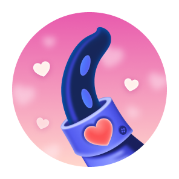 | Heart On Your Sleeve | (？？？) | <table>  <thead>  <tr>  <th>默认</th> <th>铜</th>  <th>银</th>  <th>金</th>  </tr>  </thead>  <tbody>  <tr>  <td align="center"></td>   <td>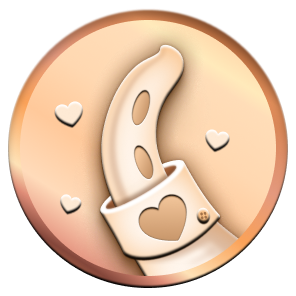</td>  <td>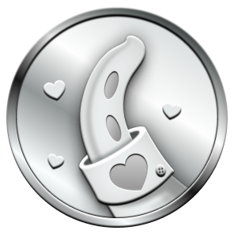</td>  <td>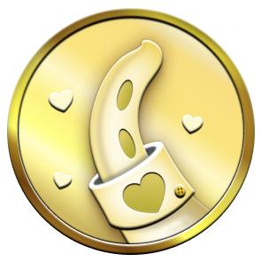</td>  </tr>  <tr>  <td align="center">(？)</td>  <td align="center">(？)</td>  <td align="center">(？)</td>  <td align="center">(？)</td>  </tr>   </tbody>  </table> |
| 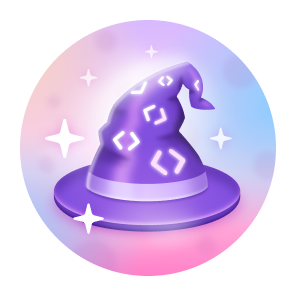 | Open Sourcerer | (？？？) | <table>  <thead>  <tr>  <th>默认</th> <th>铜</th>  <th>银</th>  <th>金</th>  </tr>  </thead>  <tbody>  <tr>  <td align="center"></td>   <td>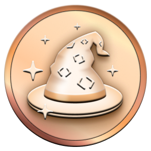</td>  <td>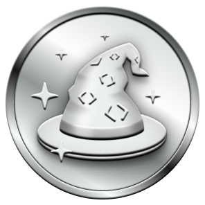</td>  <td>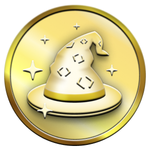</td>  </tr>  <tr>  <td align="center">(？)</td>  <td align="center">(？)</td>  <td align="center">(？)</td>  <td align="center">(？)</td>  </tr>   </tbody>  </table> |
|  | Starstruck | 创建了一个拥有许多星标的仓库 | <table>  <thead>  <tr>  <th>默认</th> <th>铜</th>  <th>银</th>  <th>金</th>  </tr>  </thead>  <tbody>  <tr>  <td align="center"></td>   <td>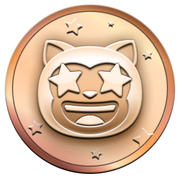</td>  <td>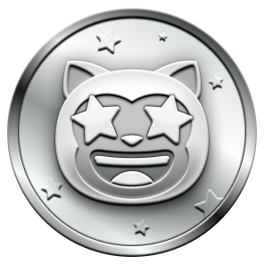</td>  <td>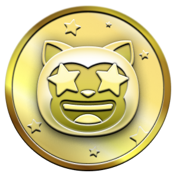</td>  </tr>  <tr>  <td align="center">16</td>  <td align="center">128</td>  <td align="center">512</td>  <td align="center">4096</td>  </tr>   </tbody>  </table>      |
| 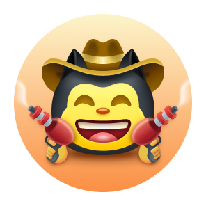 | Quickdraw | 快速完成任务！ （在打开问题/拉取请求后 5 分钟内关闭） | <table>  <thead>  <tr>  <th>默认</th>  </tr>  </thead>  <tbody>  <tr>  <td></td> </tr>  <tr>  <td align="center">1</td> </tr>   </tbody>  </table> |
|  | Pair Extraordinaire | 在合并的拉取请求中 [共同创作](https://docs.github.com/pull-requests/committing-changes-to-your-project/creating-and-editing-commits/creating-a-commit-with-multiple-authors) 提交的 commits | <table>  <thead>  <tr>  <th>默认</th> <th>铜</th>  <th>银</th>  <th>金</th>  </tr>  </thead>  <tbody>  <tr>  <td align="center"></td>   <td>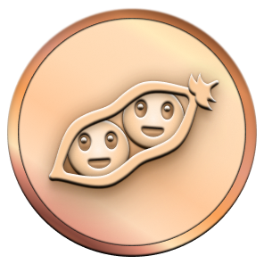</td>  <td>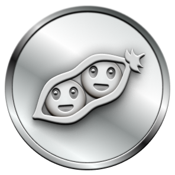</td>  <td>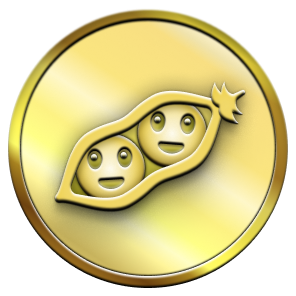</td>  </tr>  <tr>  <td align="center">1</td>  <td align="center">10</td>  <td align="center">24</td>  <td align="center">48</td>  </tr>   </tbody>  </table>      |
|  | Pull Shark | 打开一个已合并的拉取请求 | <table>  <thead>  <tr>  <th>默认</th> <th>铜</th>  <th>银</th>  <th>金</th>  </tr>  </thead>  <tbody>  <tr>  <td align="center"></td>   <td>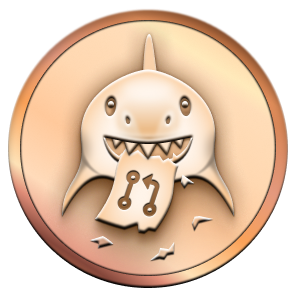</td>  <td></td>  <td></td>  </tr>  <tr>  <td align="center">1</td>  <td align="center">10</td>  <td align="center">24</td>  <td align="center">48</td>  </tr>   </tbody>  </table> |
|  | Galaxy Brain | 回答了一个讨论 (获得了一个被接受的答案) | <table>  <thead>  <tr>  <th>默认</th> <th>铜</th>  <th>银</th>  <th>金</th>  </tr>  </thead>  <tbody>  <tr>  <td></td>  <td></td>  <td></td>  <td></td>  </tr>  <tr>  <td align="center">2</td> <td align="center">8</td>  <td align="center">16</td>  <td align="center">32</td>  </tr>   </tbody>  </table>
|                  | YOLO  | 在没有审核的情况下合并了一个拉取请求  | <table>  <thead>  <tr>  <th>默认</th>  </tr>  </thead>  <tbody>  <tr>  <td></td> </tr>  <tr>  <td align="center">1</td> </tr>   </tbody>  </table> |
|                  | Public Sponsor        | 通过 [GitHub Sponsors](https://github.com/sponsors) 赞助了一位开源贡献者 | <table>  <thead>  <tr>  <th>默认</th>  </tr>  </thead>  <tbody>  <tr>  <td></td> </tr>  <tr>  <td align="center">1</td> </tr>   </tbody>  </table> |
 

# 👋 成就肤色图标 👋

#### 某些成就的外观取决于你的表情符号肤色偏好。

#### 你可以通过前往 [外观设置](https://github.com/settings/appearance) 更改你的偏好肤色。

 

| 徽章 | 名称 | 肤色版本 |
| :-: | :-: | :-: |
|           | Starstruck | <table>  <thead>  <tr>  <th>👋</th> <th>👋🏻</th>  <th>👋🏼</th>  <th>👋🏽</th>  <th>👋🏾</th>  <th>👋🏿</th>  </tr>  </thead>  <tbody>  <tr>  <td align="center"></td>   <td align="center">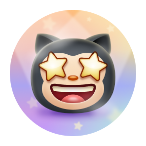</td>  <td align="center">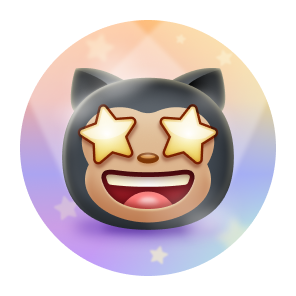</td>  <td align="center"></td>  <td align="center"></td>   <td align="center"></td>   </tr>   <tr>  <td align="center">👋</td> <td align="center">👋🏻</td>  <td align="center">👋🏼</td>  <td align="center">👋🏽</td>  <td align="center">👋🏾</td>  <td align="center">👋🏿</td>  </tr>  </tbody>  </table> |
|              | Quickdraw | <table>  <thead>  <tr>  <th>👋</th> <th>👋🏻</th>  <th>👋🏼</th>  <th>👋🏽</th>  <th>👋🏾</th>  <th>👋🏿</th>  </tr>  </thead>  <tbody>  <tr>  <td align="center"></td>   <td align="center">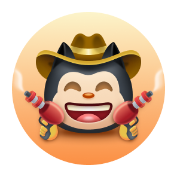</td>  <td align="center">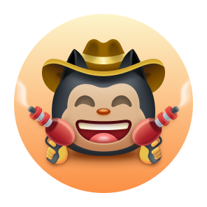</td>  <td align="center">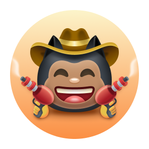</td>  <td align="center">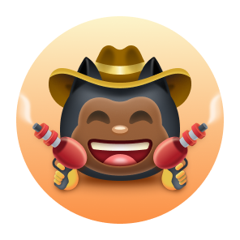</td>   <td align="center">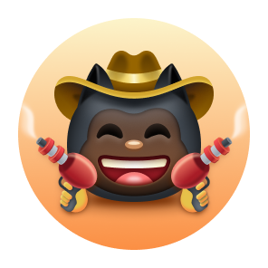</td>   </tr>   <tr>  <td align="center">👋</td> <td align="center">👋🏻</td>  <td align="center">👋🏼</td>  <td align="center">👋🏽</td>  <td align="center">👋🏾</td>  <td align="center">👋🏿</td>  </tr>  </tbody>  </table> |

 

# ✨ 高亮徽章 ✨
 

| 徽章 | 名称 | 如何获得 |
| :-: | :-: | :-: |
|   | Pro | 使用 [GitHub Pro](https://docs.github.com/en/get-started/learning-about-github/githubs-products#github-pro) |
|  |  Developer Program Member | 成为 [GitHub 开发者计划](https://docs.github.com/en/developers/overview/github-developer-program) 的注册成员 |
|  | Security Bug Bounty Hunter | 在 [GitHub Security](https://bounty.github.com/) 帮助追踪安全漏洞 |
|  | GitHub Campus Expert | 参与 [GitHub 校园计划](https://education.github.com/experts) |
|  | Security advisory credit | 提交到 [GitHub 咨询数据库](https://github.com/advisories) 的安全咨询被接受 |

 

# ❌ 不再可获得的徽章 ❌
 

| 徽章 | 名称 | 如何获得 | 所需数量 |
| :-: | :-: | :-: | :-: |
|      | Mars 2020 Contributor | 向 [火星2020直升机任务](https://github.com/readme/featured/nasa-ingenuity-helicopter) 的仓库贡献代码 | <table>  <thead>  <tr>  <th>默认</th>  </tr>  </thead>  <tbody>  <tr>  <td></td> </tr>  <tr>  <td align="center">1</td> </tr>   </tbody>  </table> |
|  | Arctic Code Vault Contributor | 向 [2020 GitHub 存档计划](https://archiveprogram.github.com/) 的仓库贡献代码 | <table>  <thead>  <tr>  <th>默认</th>  </tr>  </thead>  <tbody>  <tr>  <td></td> </tr>  <tr>  <td align="center">1</td> </tr>   </tbody>  </table> |

 

# ℹ️ 更多信息 ℹ️

#### 你可以在这个 [链接](https://docs.github.com/en/account-and-profile/setting-up-and-managing-your-github-profile/customizing-your-profile/personalizing-your-profile#displaying-badges-on-your-profile) 找到关于 GitHub 徽章的更多信息。

####  

  

